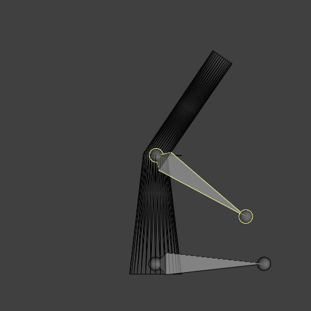

A skin uses joint weights to deform a mesh. A vertex near an elbow can follow both the upper arm and the forearm as the elbow bends. A rigid attachment, such as a tool held in a hand, follows one bone as a whole.

## Joint weights

A vertex's joint weights determine how much each bone contributes to its position. **Armature data** identifies the skeleton and **Armature object** identifies the rig that poses the mesh. Edit mode shows the rest skeleton and Pose mode shows the animated pose.

The cylinder in **File → glTF Samples → RiggedSimple** bends at **Bone.001** (frame 26). Model by Cesium. [Rigged Simple](https://github.com/KhronosGroup/glTF-Sample-Assets/tree/main/Models/RiggedSimple) · [CC BY 4.0](https://creativecommons.org/licenses/by/4.0/)

## Armature assignment

In the scene network, right-click the mesh object's **Skin armature** socket and choose a rig under **Assign**. **Clear** disconnects the rig and leaves the mesh’s skin weights available for reassignment. The picker lists rigs that use the skeleton the mesh was bound to. Meshes assigned to one rig share its pose. Separate armature objects can share a rest skeleton and pose independently. Editing that shared skeleton affects both rigs.

Skin binding and weights come from the imported asset. To bind an unweighted mesh, author the weights in the source asset and import the resulting glTF. Parenting positions the mesh within the hierarchy. Skin weights determine its deformation.

## Bone attachments

A rigid attachment follows its bone as a whole. On glTF import, a mesh instance on a joint node becomes a bone attachment when the node has no rigid-body motion of its own. Select the mesh and look under **Properties → Attached bone ID** to identify the bone.

## glTF skin import and export

- **Weights.** Each vertex can follow up to four joints. If a glTF mesh supplies more influences, MeshEditor keeps the four greatest weights and scales them to sum to one.
- **Unskinned skeleton.** Save a native project to keep an editable armature. glTF exports an unskinned skeleton as ordinary parented nodes, which reimport as an object hierarchy.
- **Added or removed bones.** A new bone affects a skin when the source weights assign vertices to it. Removing a joint used by an imported skin can cause glTF export to omit that skin.

If the mesh also has shape animation, inspect its bone channels and morph-weight channels separately. [Morph targets](/MeshEditor/manual/animation/morph-targets/)
