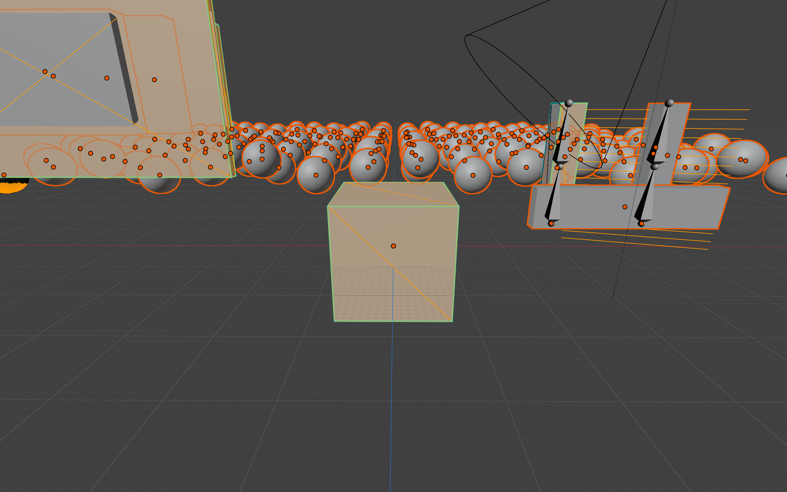
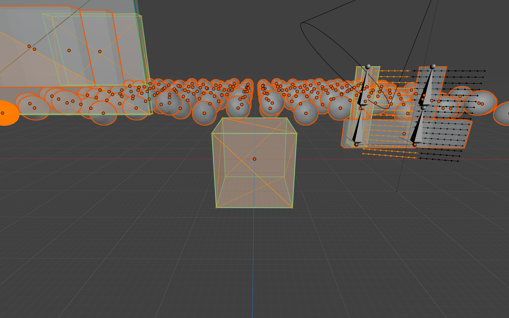

## Shading modes

Choose a shading mode in the viewport header. **Z** cycles from Solid to Material Preview to Rendered and back to Solid. From Wireframe it selects Solid. **Shift+Z** toggles between Wireframe and the previous filled mode. The arrow beside the buttons opens the settings for the current mode.

| Mode | What to inspect |
| --- | --- |
| **Wireframe** | Edge flow, overlapping parts and bones inside geometry. Adjust X-ray opacity to distinguish depth. |
| **Solid** | Shape and face orientation under workspace lights. Enable **Backface Culling** to hide back-facing surfaces. |
| **Material Preview** | Materials and textures under a repeatable studio environment. |
| **Rendered** | The shot with scene lighting, world and render settings. |

Backface visibility also determines which faces you can pick. Wireframe shows both sides. Solid uses its **Backface Culling** toggle. Material Preview and Rendered use each material’s **Double Sided** setting.

The **Material Preview lighting** and **Rendered lighting** sections appear in their respective modes. They control scene lights, the environment and exposure for the active viewport. [World and environment lighting](/MeshEditor/manual/rendering/world/)

To compare two finishes or inspect a color, roughness or normal map on its own, see [Material preview](/MeshEditor/manual/rendering/materials/preview/).

## X-ray

| Property | Description |
| --- | --- |
| **X-ray** | The header button or **Alt+Z** toggles X-ray. In Solid and Wireframe the shading popover also has a checkbox beside the **X-ray** slider. |
| **X-ray opacity** | Sets the opacity of the front surface when X-ray is on. Lower values reveal more of the geometry behind it. Solid and Wireframe each remember their own enable and opacity settings. |

In mesh Edit mode, enabling X-ray lets you select elements behind the front surface, even at full opacity. In Material Preview and Rendered this uses the Solid X-ray setting. The material stays opaque where it normally would, and hidden edit wires appear dimmed.

## Solid lighting

In the Solid shading popover, **Solid lighting** contains four independently adjustable lights.

| Property | Description |
| --- | --- |
| **Reset** | Restores the four lights, ambient color and specular highlights to their defaults. |
| **Specular highlights** | Shows the highlights from the four lights in Solid shading. |
| **Ambient color** | Color of the fill light on all surfaces, including those facing away from the lights. |

### Light 1–4

| Property | Description |
| --- | --- |
| **Direction** | X, Y and Z direction of this light. Changing it moves the lit side of a surface. |
| **Diffuse color** | Color and brightness this light contributes to diffuse shading. |
| **Specular color** | Color and brightness this light contributes to highlights when **Specular highlights** is on. |
| **Wrap** | How far this light’s diffuse contribution extends around the surface. Higher values soften the transition into shadow. |

For image-based illumination or authored light objects, use Material Preview or Rendered. [World and environment lighting](/MeshEditor/manual/rendering/world/)

## Overlays

Show or hide all guides with the overlays button in the viewport header. Open its arrow to choose individual guides.

| Overlay | What it shows |
| --- | --- |
| **Grid** | Ground grid and axes. |
| **Extras** | Outlines for cameras, lights, empties and colliders. |
| **Bones** | The armature. |
| **Origins** | Origin markers for the active and selected objects. |
| **Outline Selected** | Outlines of selected objects. |

### Selection overlays

**Scene controls → Render → Selection overlays** appears when an object is selected.

| Property | Description |
| --- | --- |
| **Vertex Normals** | Draws a normal line at each vertex of a selected mesh. |
| **Face Normals** | Draws a normal line at the center of each face. |
| **Bounding Boxes** | Draws the enclosing box of each selected mesh. |
| **Tet Wireframe** | Draws the edges of the selected object’s tetrahedral mesh when it has one. |

[Normals and smooth shading](/MeshEditor/manual/modeling/normals/)
