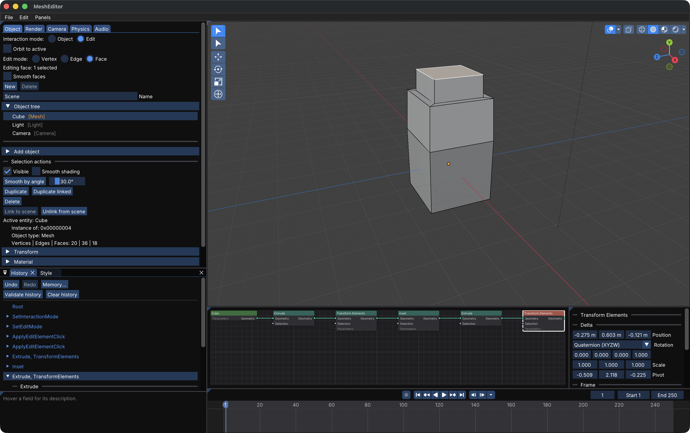

## Mesh elements

A mesh consists of vertices, edges and faces. A vertex has a position in mesh-local coordinates. An edge joins two vertices. A face’s boundary order, or *winding*, determines which side faces out.

A *corner* is a vertex’s occurrence in one face. Two faces can share a vertex and still use different UV coordinates or colors at that corner. A boundary edge belongs to one face. A mesh can also contain loose edges, isolated vertices and disconnected islands.

## Mesh primitives

Choose **Scene controls → Scene → Add object** and add a mesh primitive. Select its generator in **Nodes** to change its dimensions or resolution. Increasing the segment count changes the elements available for later selections.

| Primitive | Shape and controls |
| --- | --- |
| **Plane** | A grid with half extents and subdivisions in two directions. Subdivide it for displacement away from the corners. |
| **Circle** | An edge loop, a single filled polygon or a triangle fan with a center vertex. |
| **Cube** | A box specified by its half extents. A half extent of 1 gives a side length of 2. |
| **UV Sphere**, **Ico Sphere**, **Quad Sphere** | Choose latitude and longitude, subdivided triangles, or six subdivided square patches. |
| **Torus** | A ring with independent radii and segment counts around the ring and its tube. |
| **Cylinder**, **Cone** | A cylinder with a separate top radius. Reduce it for a taper or set it to zero for a cone. Ends can be open, polygon caps or triangle fans. |

## Edit mode

In **Edit** mode, select vertices, edges or faces. Each edit appears as a node in the geometry procedure. To change where an earlier bevel or extrusion acts, edit the selection on that node. [Mesh selection](/MeshEditor/manual/modeling/selection/) · [Geometry procedures](/MeshEditor/manual/modeling/geometry-nodes/)

## In this section

- [Mesh selection](/MeshEditor/manual/modeling/selection/)
- [Mesh topology](/MeshEditor/manual/modeling/topology/)
- [Mesh deformation](/MeshEditor/manual/modeling/reshape/)
- [Boolean modeling](/MeshEditor/manual/modeling/booleans/) combines solids and cuts one shape from another.
- [Subdivision and symmetry](/MeshEditor/manual/modeling/surface-refinement/)
- [Normals and smooth shading](/MeshEditor/manual/modeling/normals/)
- [UV maps and color attributes](/MeshEditor/manual/modeling/uvs/)
- [Geometry procedures](/MeshEditor/manual/modeling/geometry-nodes/)
- [Fields and attributes](/MeshEditor/manual/modeling/fields/)
- [Geometry instances](/MeshEditor/manual/modeling/instances/)
- [Geometry node reference](/MeshEditor/manual/modeling/nodes/) lists geometry nodes, sockets and settings.
- [MaterialX operations](/MeshEditor/manual/modeling/materialx/) lists MaterialX nodes and their supported socket types.
