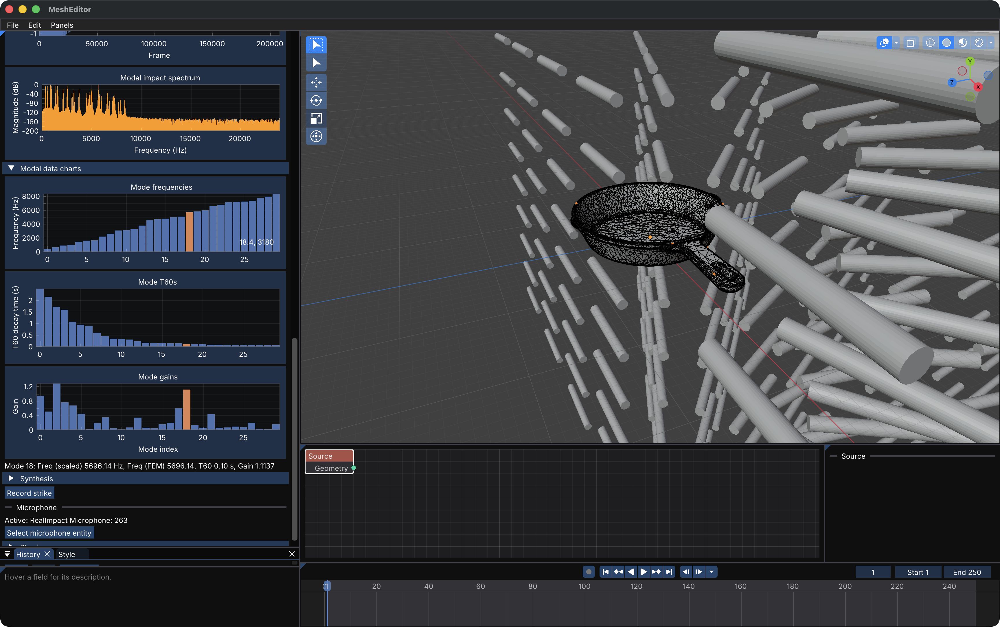

A sound object can play recordings attached to mesh vertices or synthesize sound from the mesh’s shape and mechanical material. An object with both sources has a **Recordings** / **Modal** selector in **Properties → Audio**.

## Excite mode

In **Excite** mode, a click strikes the mesh. With overlays enabled, dots mark the available strike locations. **Vertex** in the object's **Audio** properties selects a location by vertex number. **Excite** sounds that vertex. Leaving the mode restores the previous mesh selection.

A glTF object with a precomputed modal model and strike positions is playable as soon as it opens. **Delete sound object** removes the audio setup and leaves the mesh in the scene. A native project saves the audio setup with the mesh.

## In this section

- [Recorded impacts](/MeshEditor/manual/physical-audio/recordings/)
- [Modal models](/MeshEditor/manual/physical-audio/solving/)
- [Strikers and contact sound](/MeshEditor/manual/physical-audio/contact/)
- [Surface finish](/MeshEditor/manual/physical-audio/surface-finish/)
- [Audio playback and recording](/MeshEditor/manual/physical-audio/listening/)
