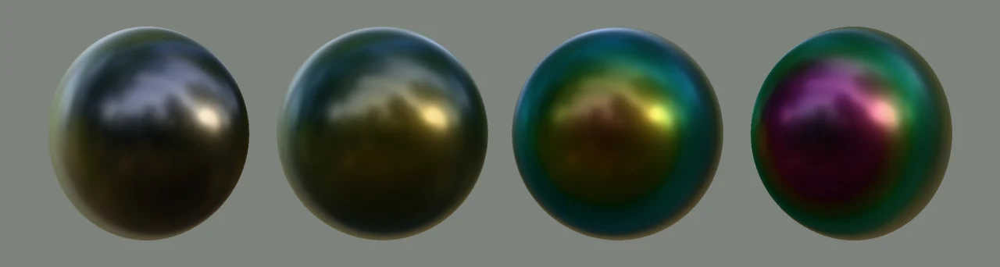

Surface layers change how a finish reflects light. Enable the effect on the mesh under **Properties → Material**, then use **Go to** beside the assigned material to edit its properties.

## Clearcoat

Clearcoat adds a reflective layer over the base surface.

| Property | Description |
| --- | --- |
| **Factor** | Strength of the reflective coat over the base material. Zero removes the coat’s contribution. |
| **Texture** | Red channel multiplies the coat factor across the surface. |
| **Roughness** | Spread of the coat highlight, independent of the base surface roughness. |
| **Roughness Texture** | Green channel multiplies the coat roughness. |
| **Normal Texture** | Tangent-space normal map for the coat. It can give the coat a different surface direction from the base material. |
| **Normal Scale** | Multiplier on the coat normal map’s X and Y components. At 0 the map adds no tilt. |

## Sheen

Sheen adds the soft reflection characteristic of fabric.

| Property | Description |
| --- | --- |
| **Color** | Tint and strength of the sheen reflection. Black gives no sheen. |
| **Color Texture** | sRGB image that multiplies the sheen color. |
| **Roughness** | Spread of the sheen highlight. |
| **Roughness Texture** | Alpha channel multiplies the sheen roughness. |

## Anisotropy

Anisotropy gives reflections a preferred direction, as on brushed metal.

| Property | Description |
| --- | --- |
| **Strength** | Amount the highlight stretches along the surface. At zero it has no preferred direction. |
| **Rotation** | Counterclockwise angle in degrees from the mesh tangent to the anisotropy direction. |
| **Texture** | Red and green give the direction along the surface. Blue multiplies the strength. |

## Iridescence

Iridescence shifts the color of a reflection with viewing angle, as on a thin oil film.

| Property | Description |
| --- | --- |
| **Factor** | Amount of thin-film interference in the reflection. |
| **Texture** | Red channel multiplies the iridescence factor. |
| **IOR** | Index of refraction of the thin film. |
| **Thickness Minimum** | Film thickness in nanometers where the thickness texture’s green channel is 0. |
| **Thickness Maximum** | Film thickness in nanometers where the green channel is 1. Without a thickness texture, this value applies across the whole surface. |
| **Thickness Texture** | Green channel varies the film thickness between the minimum and maximum, changing the colors of the reflection. |

From left to right, the metal is bare, then coated with films of 200, 400 and 650 nm. All three films have an IOR of 1.5.
