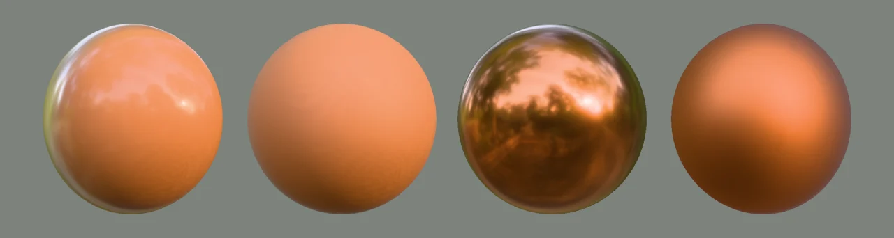

**Base color**, **Metallic** and **Roughness** determine the color of a surface and how clearly it reflects its surroundings.

The first pair has **Metallic** 0 and the second pair has **Metallic** 1. In each pair, **Roughness** increases from 0.18 to 0.65. The base color is the same throughout.

## Base color, metallic and roughness

| Property | Effect |
| --- | --- |
| **Base color** | Surface color of a nonmetal or reflection tint of a metal. RGB multiplies the base color texture and vertex color. Alpha contributes to coverage in Mask and Blend modes. |
| **Base Color Texture** | sRGB image for the base color. RGB supplies color and alpha supplies coverage. White **Base color** preserves the image colors. |
| **Metallic** | Use 0 for nonmetals such as paint and 1 for bare metal. A metallic map can distinguish intact paint from exposed metal on one part. |
| **Roughness** | Spread of reflections. Low values give sharp reflections. High values give broad highlights. |
| **Metallic Roughness Texture** | Data image that multiplies **Metallic** by its blue channel and **Roughness** by its green channel. |

## Specular reflection

**Specular** controls the reflection at the surface of a nonmetal. [Transparency and transmission](/MeshEditor/manual/rendering/materials/transparency/)

| Property | Description |
| --- | --- |
| **IOR** | Index of refraction. On a nonmetal it sets the strength of reflections viewed straight on. On a transmitting material it also controls how strongly light bends. |
| **Factor** | Strength of the dielectric reflection. Found under **Specular**. |
| **Texture** | Alpha channel multiplies the specular **Factor** across the surface. |
| **Color Factor** | Tint of the dielectric reflection when viewed straight on. |
| **Color Texture** | sRGB image that multiplies **Color Factor**. |

## Normal maps

| Property | Description |
| --- | --- |
| **Normal Texture** | Tangent-space normal map. Its RGB channels vary the shading direction across the surface while preserving the mesh silhouette. Load it as a data texture. |
| **Normal Scale** | Multiplier on the map’s X and Y components. At 0 the map adds no relief. A negative value reverses the lateral tilt. |

## Ambient occlusion

| Property | Description |
| --- | --- |
| **Occlusion Texture** | Data texture whose red channel darkens indirect light where the map indicates occlusion. Can share an image with the metallic and roughness channels. |
| **Occlusion Strength** | Amount of the map applied, from 0 (no darkening) to 1 (full effect). |

## Emission

| Property | Description |
| --- | --- |
| **Emissive** | Color added by emission. White preserves the emissive texture's colors. The surface can still reflect light. |
| **Emissive Strength** | Brightness multiplier for the emitted color. |
| **Emissive Texture** | sRGB image that multiplies **Emissive**, controlling emission across the surface. |

## Unlit

**Unlit** draws the base color, texture and vertex colors independently of the scene lighting.

## Material animation

Material keyframes apply to every mesh using the material. The keyframe control beside an animatable field adds or removes a key at the current frame. [Animated material properties](/MeshEditor/manual/animation/keyframes/#animated-material-properties)
