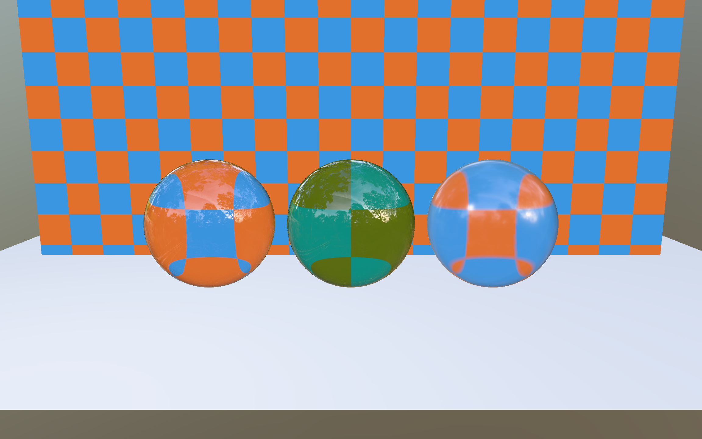

Alpha controls coverage. Transmission controls how light passes through the covered surface.

## Alpha modes

The alpha components of the base color, base color texture and vertex color multiply together to give the surface alpha.

| Property | Description |
| --- | --- |
| **Alpha Mode** | **Opaque** treats the surface as fully covered. **Mask** discards fragments below a threshold. **Blend** makes the surface partly transparent according to alpha. |
| **Alpha Cutoff** | Threshold used in **Mask** mode. Alpha values below the cutoff are discarded. Raising it enlarges the cutouts. |

## Sidedness

**Double Sided** draws the back faces too, with their shading normals reversed. When disabled, the material is visible only from the front.

## Specular transmission

The mesh’s **Transmission** feature enables specular transmission. The material controls where it appears.

| Property | Description |
| --- | --- |
| **Factor** | Fraction of light transmitted through the nonmetallic part of the surface. At 1 it transmits fully apart from reflection and absorption. |
| **Texture** | Red channel multiplies the transmission factor. |
| **IOR** | Index of refraction of the base surface. Controls how strongly transmitted light bends. |
| **Roughness** | Base surface roughness. Increasing it blurs detail seen through the material. |
| **Dispersion** | Amount by which different wavelengths refract at different angles. Increasing it separates colors more strongly. |

In raster shading, **Real transmission** shows the scene behind the material. With it off, the transmitted light comes from the environment.

[Render settings](/MeshEditor/manual/rendering/lighting/#lighting-methods)

## Thickness and absorption

| Property | Description |
| --- | --- |
| **Thickness** | Distance through the material below the surface. Zero treats the surface as a thin sheet. |
| **Thickness shape** | Approximation of the exit surface for a volume with positive thickness. **Sphere** uses a rounded boundary. **Slab** uses parallel planes. |
| **Thickness Texture** | Green channel multiplies the thickness across the surface. |
| **Attenuation Color** | Color that initially white light takes on after traveling the attenuation distance through the material. |
| **Attenuation Distance** | Distance in meters over which white light reaches **Attenuation Color**. Shorter distances strengthen absorption. Zero disables it. |

In **File → Examples → RayTracingGlass.gltf**, **Clear glass** (left) shows the checkerboard through the surface. **Green absorption** (center) tints the tiles. **Frosted glass** (right) uses higher roughness to soften their edges.

## Diffuse transmission

With **Diffuse transmission** enabled on the mesh, light from behind can brighten the front of a thin surface. The light is scattered, so objects behind the surface remain indistinct.

| Property | Description |
| --- | --- |
| **Factor** | Fraction of light diffusely transmitted through the material. |
| **Texture** | Alpha channel multiplies the diffuse transmission factor. |
| **Color** | Tint of the diffusely transmitted light. |
| **Color Texture** | sRGB image that multiplies the transmission color. |
